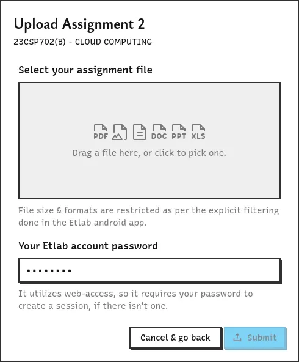
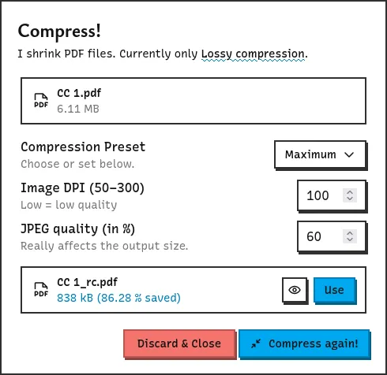
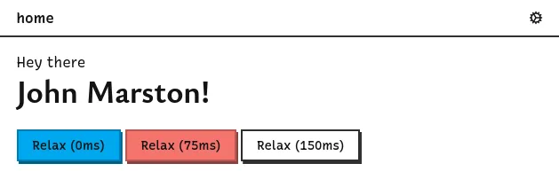

> ##### TL;DR
>
> Much faster logins, Assignment upload & delete, client-side PDF compression, display names for greeting, improvements to the PWA and many bug fixes.

## Quicker Logins

New and existing users should be able to login to Ret at least 10 seconds faster now, as Ret no longer depends on the dashboard API call to fetch critical information such as semester ID.
Such information were in the login response itself all this time. I have no idea how I missed something as important as that.

Anyway, it's faster now, so enjoy that!

## Better Assignments!

This update implements functionality for the dead upload & delete assignment buttons in the assignments page.
It utilizes web access to perform those operations, because the native APIs have some weird behavior.
So, you will have to enter your password (btw, just save in your browser with autofill).

Does the password thing seems unnecessarily time wasting? Don't worry, because this update also brings...

## Client-side PDF Compression

**Fully client-side PDF compression, done right in your browser: no uploads or downloads!**
Scanned file too large?
Compress it right before you upload... or not.
Whatever you prefer.
Please be aware that the compression is fully lossy.

## Display Name

The dashboard now greets you.
But that greeting could be a bit too long if your profile name from Etlab is your full name.
In such cases, or for fun, you can set up a display name in settings; or in the dashboard itself if you're doing it for the first time.
This display name will be used across Ret to greet you (just in the dashboard for now).

## Updates to the PWA

If you have installed Ret as a PWA on your device, it should now show you shortcuts to Assignments, Results, Attendance and Settings pages.
If you have a good launcher, you should be able to search for shortcuts and launch those pages directly.

## Bug Fixes

- Duplicate subject entries causing the grade subject list in academic analysis to not open, because it was not handled properly.
  Ret now deduplicates subjects before even sending it to the client.
- Fixed a critical bug that prevented the official notification server from working correctly.
  Without explicitly mentioning the Content-Type header in requests to Ret, it would get rejected because it was considered as cross-site form action data, which was disallowed.
- Switch & checkbox border colors are now consistent with the rest of the application.
- Theme color was set for dark and light mode for better integration with your browser & device.
- The graph tooltip data in academic analysis page is now always shown above the graph for convenience for mobile users.

<address>Dunks</address>
