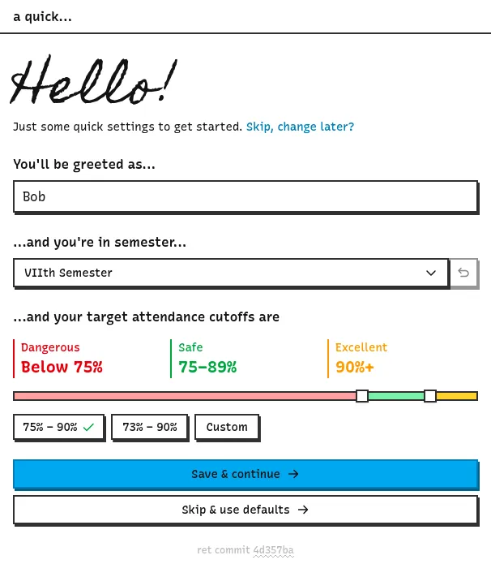

> ##### TL;DR
>
> Made new user experience much better.

# Hello new users!

This update makes it easier for new users to onboard to Retlab.
It is kept relatively simple & **completely optional** to not be a trouble.

You will be asked to provide a display name, ensure your current semester and the attendance percentage cutoffs which you can adjust with the slider or presets.

If you are an existing user, you won't prompted to complete onboarding because you may have adjusted the settings already.
But, you can visit the [/hello route](/hello) if you are an existing user to onboard.

<address>Dunks</address>
