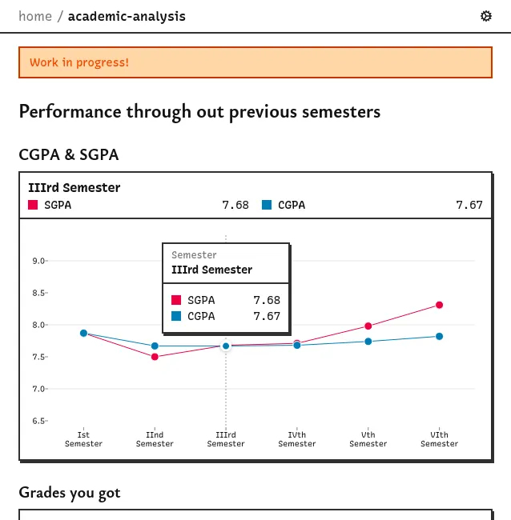
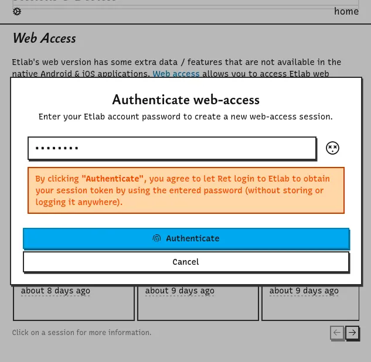
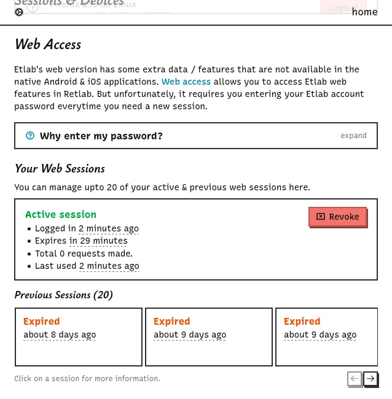
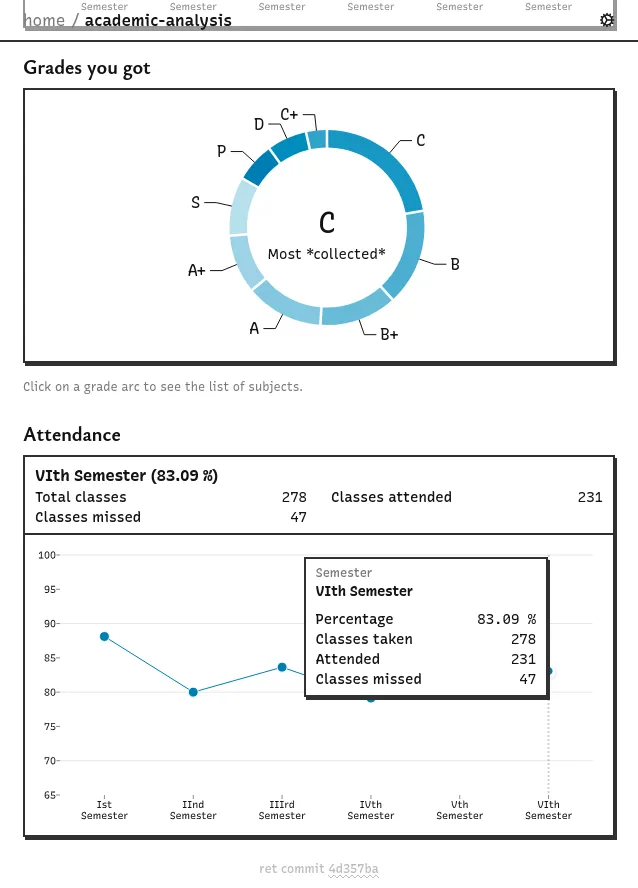
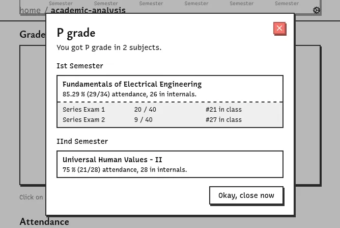
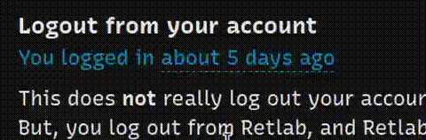

> ##### TL;DR
>
> Web access, academic analysis page with cool graphs, relative timestamps, and bug fixes.

## Etlab web features in Ret

Etlab web is a more cooler, stable, and data-rich client than the Etlab Android & iOS native clients.
So, it would be cool to implement some kind of a bridge that allows web features to be used in Ret.
And that's web access!
It allows you to access supported web features in Ret.

## Nice graphs!

Currently, the web-access feature powers the new academic analysis page this update introduces.
This brings the data from the academic analysis page in Etlab web and tries to present it in a fun way with graphs and statistics.

## Misc.

All timestamps in Ret are now showed as relative timestamps.
You can hold the timestamp to toggle between it's absolute and relative forms.

Also resolved a critical bug how some states were resolved, which didn't really resolve them :(

<address>Dunks</address>
